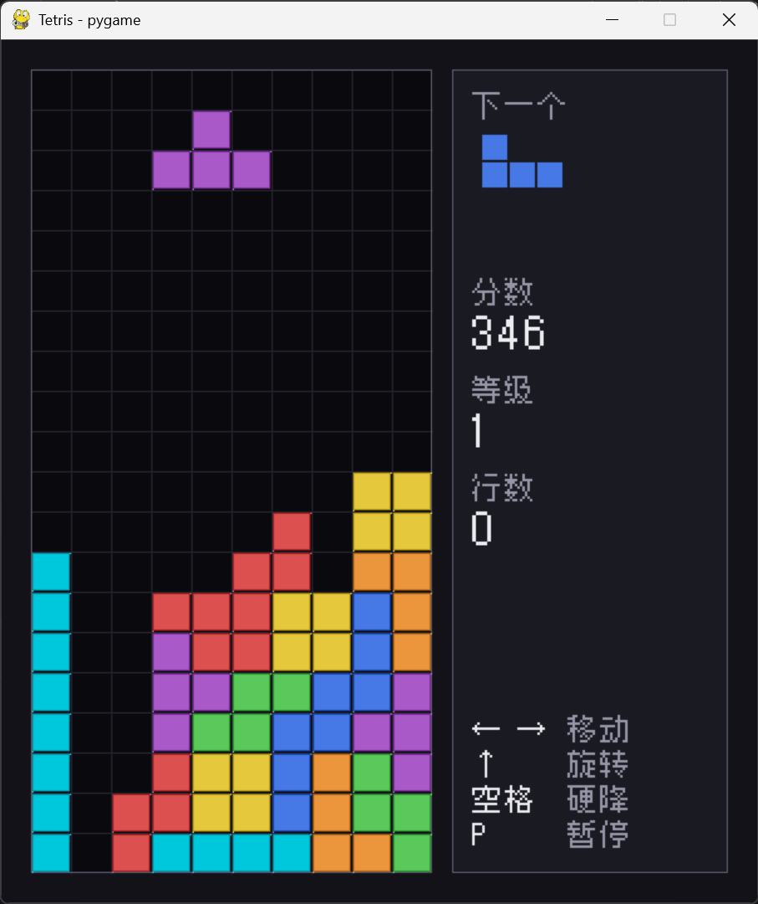

# 俄罗斯方块（pygame）

一个用 Python + [pygame-ce](https://pyga.me/) 写的俄罗斯方块，像素风中文界面。
代码按「配置 / 方块 / 场地 / 规则 / 渲染 / 入口」拆成 6 个模块，逻辑层不依赖窗口，可以脱离显示器单独测试。



<p align="center"><i>游戏进行中：左侧场地与幽灵落点、右侧下一个方块预览和分数面板</i></p>

## 特性

- 标准 10×20 场地，7 种方块，4×4 矩阵表示 + 矩阵旋转
- 贴墙旋转自动修正（简化版 wall kick）
- 7-bag 随机（每 7 个方块里七种各出现一次，手感接近现代俄罗斯方块）
- 幽灵方块落点预览（`G` 键开关）
- 下一个方块预览，分数 / 等级 / 行数面板
- 消行计分，每 10 行升级，等级越高下落越快
- 长按左右键连续移动（DAS：延迟 170ms，之后每 50ms 一格）
- 暂停、重新开始、游戏结束覆盖层
- 时间驱动（`dt` 毫秒），与帧率无关，掉帧不会让游戏变慢
- 像素风中文字体 + 中文界面（字体缺失时自动退回默认字体）

## 操作

| 按键 | 作用 |
| --- | --- |
| `←` `→` | 左右移动（按住连续移动） |
| `↓` | 软降，每格 +1 分 |
| `空格` | 硬降，直接落底并锁定 |
| `↑` | 顺时针旋转 |
| `Z` | 逆时针旋转 |
| `G` | 开关幽灵方块 |
| `P` | 暂停 / 继续 |
| `R` | 重新开始 |
| `ESC` | 退出 |

按键可以在 `settings.py` 里随意改。

## 运行

需要 Python 3.10+（开发环境是 3.14）。

```bash
# 1. 建虚拟环境
python -m venv .venv

# 2. 装依赖
#    Windows
.venv\Scripts\python.exe -m pip install -r requirements.txt
#    macOS / Linux
.venv/bin/python -m pip install -r requirements.txt

# 3. 开始游戏
#    Windows
.venv\Scripts\python.exe main.py
#    macOS / Linux
.venv/bin/python main.py
```

> **为什么用 `pygame-ce` 而不是 `pygame`**：Python 3.13+ 上官方 `pygame` 还没有预编译轮子，pip 会去编译源码（需要 SDL2 + 编译器，通常直接失败）。`pygame-ce` 是社区维护分支，API 完全兼容，代码里照样 `import pygame`。

## 项目结构

| 文件 | 职责 |
| --- | --- |
| `settings.py` | 全部常量：窗口、尺寸、配色、速度、计分、键位、字体 |
| `tetromino.py` | 7 种形状的 4×4 矩阵、旋转、方块位置、7-bag 随机器 |
| `board.py` | 场地网格、碰撞检测、锁定、消行 |
| `game.py` | 状态机、按键处理、时间推进、计分升级、踢墙判定 |
| `renderer.py` | 只做「数据 → 像素」，不修改游戏状态 |
| `main.py` | 初始化、主循环、退出清理 |

依赖是单向的：`main → game → board / tetromino → settings`，`main → renderer → settings`。

## 实现要点

- **坐标**：逻辑上用格子坐标 `(col, row)`，像素只在 `renderer.cell_rect()` 里换算一次。
- **旋转**：每个形状存成 4×4 的 0/1 矩阵，旋转就是 `new[r][c] = old[n-1-c][r]`；所有形状大小统一，I 型和 O 型不需要特例。
- **碰撞**：对候选格子逐个检查越界与占用；`row < 0`（棋盘上方）视为合法，让方块能从顶部外进入。
- **下落**：`update(dt)` 累加毫秒，攒够一个间隔才下移一格，与帧率解耦。
- **DAS**：记录 `KEYDOWN` / `KEYUP`，按下立刻走一格，170ms 后开始按 50ms 间隔连发。

## 字体与授权

界面使用 [ZPix（最像素）](https://github.com/SolidZORO/zpix-pixel-font)，文件位于 `assets/fonts/zpix.ttf`。

该字体对**个人项目和教育项目免费**，**商业产品需向作者购买授权**。如果你要用于商业项目，建议换成 OFL 授权的像素字体（例如 [缝合像素字体](https://github.com/TakWolf/fusion-pixel-font)），只需改 `settings.py` 里的 `FONT_NAME` 一行。

字体文件缺失时程序不会崩，会自动退回 pygame 默认字体（那种情况下中文显示为方块）。

## 开发工具（可选）

```bash
.venv/Scripts/python.exe -m pip install ruff   # Windows
ruff format .        # 格式化（会压平手写的注释对齐）
ruff check --fix .   # 静态检查 + 自动修复
```

配置见 `pyproject.toml`。

## 还可以做的

- 音效（移动 / 旋转 / 消行 / 结束）
- 落地微调（lock delay）：落地后还有 200ms 可以左右挪
- 暂存方块（hold）
- 消行动画、最高分存档

## License

代码以 MIT 协议开源；`assets/fonts/zpix.ttf` 的授权见上文。
